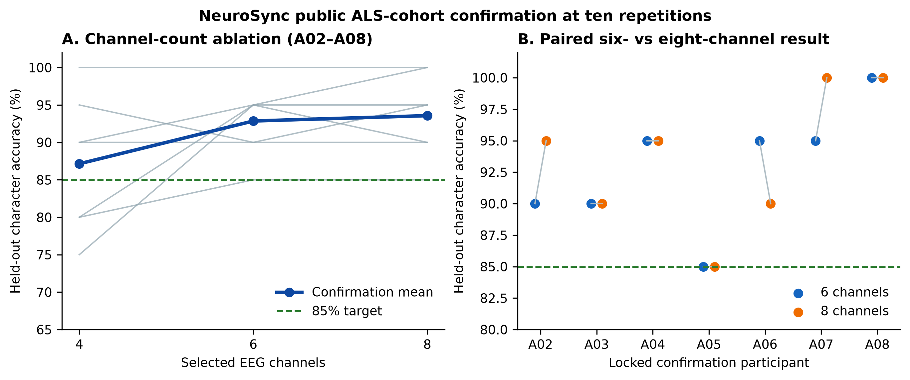

# NeuroSync: Reproducible Sparse P300 Decoding with External Boundary Validation

## Abstract

Reducing EEG channels could make P300 BCIs easier to deploy, but a compact
montage is useful only if it preserves communication performance and exposes
failure modes. NeuroSync is a reproducible sparse-P300 framework that separates
electrode-count feasibility, robustness mechanisms, and dry-electrode
equivalence. In BNCI 2014-008, an eight-channel active-electrode P300 speller
cohort of eight people with ALS, A01 froze the method and A02--A08 were locked
for confirmation using the source temporal split. Six training-selected
channels achieved 92.9% mean held-out character accuracy at ten repetitions,
compared with 93.6% using eight channels; every confirmation participant
reached at least 85%. The paired difference was -0.7 percentage points
(participant-bootstrap 95% interval -2.86 to +1.43).

We then built an event-audited EDF adapter and tested all 13 available
bigP3BCI Study A participants using file-disjoint Train02-to-Test06 recordings.
The 9x8 random paradigm is evaluated as target-event detection rather than
incorrectly converted into a 6x6 character score. Six channels achieved mean
held-out AUC 0.724 versus 0.773 with 32 channels (paired difference -0.049;
95% interval -0.077 to -0.022). A leave-one-trial stability selector did not
improve the held-out subset. NeuroSync therefore establishes sparse
active-electrode feasibility in a locked ALS cohort while falsifying universal
sparse/full parity in an external paradigm. Geometry/contact-aware selective
actions are supplied as testable mechanisms, not unproven clinical benefits.

## 1. Central question

> Under what acquisition conditions can a personalised 4--6-channel P300
> decoder retain useful communication performance relative to a fuller montage,
> and when does sparse sensing fail?

This question is stronger than asking whether a compact montage can produce a
single high accuracy number. Communication systems must distinguish wrong
outputs, abstention, repetitions, and recovery burden. NeuroSync makes these
separate outcomes rather than allowing accuracy alone to hide failures.

## 2. Contribution

NeuroSync is an evidence-first integration contribution. Its contribution is
not the invention of LDA, channel selection, or EEG quality metrics. It is a
reproducible research design with four linked pieces:

1. a locked ALS-cohort test of the electrode-count hypothesis;
2. a protocol-specific, file-disjoint external test that preserves the
   external paradigm's correct endpoint;
3. an explicit negative control for a plausible montage-stability mechanism;
   and
4. a transparent framework for future contact-aware and
   measured-forward-model ablations.

## 3. Methods

### 3.1 Locked ALS confirmation

BNCI 2014-008 records 35 copy-spelled characters from each of eight people
with ALS, using eight active Ag/AgCl EEG channels at 256 Hz. The repository
audits every event table for trial count, code count, and target-row/column
consistency. The official first 15 characters form calibration; the final 20
feedback characters remain outside selection and fitting. A01 determined the
100--800 ms feature window, eightfold temporal downsampling, 0.10 covariance
shrinkage, and trial-fold forward selection. A02--A08 are confirmation only.

### 3.2 External boundary validation

The complete bigP3BCI Study A cohort is evaluated with the original sampled EDF
markers. The external 9x8 random paradigm has 120 unique stimulus codes per
trial; NeuroSync therefore reports target-versus-nontarget event AUC instead
of inventing a character metric. For each participant, personalised selection
and fitting use Train02; evaluation uses the later Test06 file. The analysis
compares six selected channels with all 32 channels. Participants, not events,
are the independent unit for cohort inference.

### 3.3 Mechanism discipline

The framework includes optional quality gating and a supplied-forward-model
interface for observability diagnostics. The bundled 10--20 values are an
illustrative proxy, not an anatomical BEM/FEM model. A leave-one-trial
stability selector was added as a training-only negative control.

## 4. Results

### 4.1 Six-channel feasibility is supported in one ALS cohort

At ten repetitions, A02--A08 means were 87.1%, 92.9%, and 93.6% for four, six,
and eight channels. Six-channel participant accuracies were 90%, 90%, 95%,
85%, 95%, 95%, and 100%. The six-channel result is close to eight channels in
this acquisition setting and meets the retrospective five-point engineering
screen; it is not a prospective clinical non-inferiority result.

### 4.2 Universal sparse parity is not supported externally

Across 13 bigP3BCI participants, mean external event AUC was 0.724 for six
channels and 0.773 for 32 channels. The paired bootstrap interval for the
six-minus-32 difference was -0.077 to -0.022. Six channels were higher in only
3/13 participants. This boundary result is central: sparse performance depends
on the person and acquisition paradigm.

### 4.3 A simple stability mechanism did not close the gap

On the untouched external confirmation subset, stability selection yielded AUC
0.670 versus 0.698 for ordinary forward selection. It is retained as a
negative control, not presented as an improvement.

## 5. Interpretation and next test

NeuroSync has established a narrow but meaningful result: six personalised
active channels can retain near-eight-channel character accuracy in a locked
ALS cohort. It has also established where that result fails to generalise. The
next decisive study must compare empirical selection, measured
geometry-constrained selection, geometry plus measured contact quality, and an
eight-channel wet reference under a frozen held-out-session protocol.

The study must record electrode type, contact/impedance, setup time, comfort,
fatigue, marker latency, packet loss, correct accepted-output rate, wrong
accepted-output rate, coverage, and repetitions. Until that study exists,
NeuroSync makes no dry-electrode, home-use, safety, or clinical-benefit claim.

## References

1. Farwell LA, Donchin E. Talking off the top of your head. *Electroencephalogr Clin Neurophysiol*. 1988;70:510--523.
2. Riccio A, et al. Attention and P300-based BCI performance in people with ALS. *Front Hum Neurosci*. 2013;7:732.
3. Clements JM, et al. Comparison of dry and gel based electrodes for P300 BCI. *J Neural Eng*. 2016;13:066020.
4. Colwell KA, et al. A comparison of online electrode selection methods for P300 BCI. *J Neural Eng*. 2014;11:066012.
5. Mainsah B, et al. bigP3BCI: An Open, Diverse and Machine Learning Ready P300-based Brain-Computer Interface Dataset. PhysioNet. 2025. doi:10.13026/0byy-ry86.
